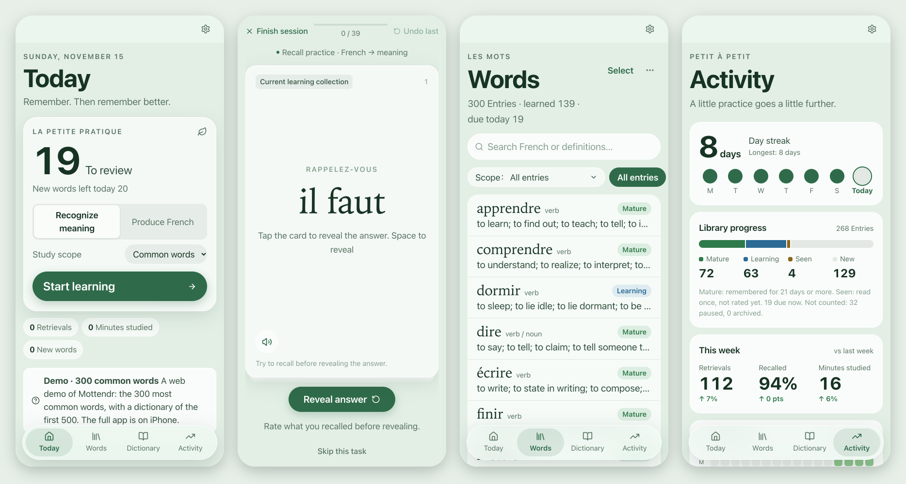
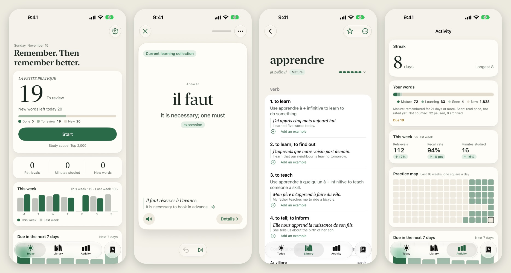

# Mottendr

[](https://github.com/beandecode/mottendr/actions/workflows/ci.yml)

**A local-first French vocabulary app with spaced repetition, built as a web app first and now as a native iPhone app.**
This repository is the web version in demo form: **300 of the most common French words** and a dictionary of the first
500, with full study flow, statistics and offline support.

- **Live demo:** <https://mottendr.givemeachance.qzz.io/app/> (installable, works offline)
- **Project page:** <https://mottendr.givemeachance.qzz.io> (a one-page overview)
- **iPhone app:** free on the App Store, coming soon (not yet released). See [the iOS app](docs/ios.md).
- **Case study:** [how and why it was built](docs/case-study.md)
- **Privacy and support:** [privacy policy](docs/privacy.md) · [support](docs/support.md)



<sub>Screenshots of the live demo with its sample progress loaded. Also: the dark theme
([Today](docs/images/today-dark.png), [word list](docs/images/words-dark.png),
[activity](docs/images/activity-dark.png)) and the [dictionary](docs/images/dictionary-light.png).</sub>

**The native iPhone app** (App Store release planned, free):



## What it does

- **Spaced repetition with FSRS-6** (`ts-fsrs`). First exposure is kept apart from scored recall; every answer is stored as a
  review event, with conflict detection between writers and undo.
- **Two directions:** French to meaning, and meaning to French (production, with separate tasks for Chinese and
  English prompts).
- **Structured vocabulary:** parts of speech and senses, gender, examples, word forms, 23 conjugation slots, linked
  pronominal verbs, word families. Chinese, Chinese with English, or English-only explanations.
- **Local-first:** everything lives in the browser (IndexedDB) and works offline after the first load. No account, no
  server, no tracking.
- **Statistics:** streak, heat map, due forecast, progress per stage.

## Engineering notes

- **Layered data.** The built-in word list is a read-only, versioned content pack. The learner's data stores only what
  differs from it (personal notes, own entries, flagged problems), addressed by stable IDs, so a pack update reaches
  every unedited field and conflicts are listed for a decision.
- **Incremental persistence.** Changes run through immer; only changed records are validated and written to IndexedDB
  (a review writes about 2 KB instead of the whole ~10 MB state). Writes are revision-checked.
- **Content as data.** Pack and dictionary ship as content-hashed JSON files, precached by a small hand-written
  service worker; the app bundle is a single JS file of about 715 kB.
- **One schema.** The entry structure is written once in TypeBox and yields the TypeScript types, the validation and a
  JSON Schema.
- **Tested logic.** The scheduler, session queue, layers, backup and statistics have unit tests on fixed inputs. The same
  logic is the specification for the native Swift port (see [the iOS app](docs/ios.md)).

## Develop

Requires Node 24 and pnpm (see `packageManager` in `package.json`).

```sh
pnpm install --frozen-lockfile
pnpm dev        # http://127.0.0.1:5173
pnpm check      # type check
pnpm test       # unit tests
pnpm build      # dist/: the app, content files and service worker
```

Stack: React 19, TypeScript, Vite, immer, TypeBox, Ajv, ts-fsrs, IndexedDB, Vitest.

## The demo and the full app

The demo holds only a fully checked cut of the content: the first 300 words of the app's first release (ordered by
word frequency) as the word list, and the dictionary records of the first 500. Backup import and restore are switched
off. A button on the Today screen loads a month of sample progress so every screen has something to show. The full
content pipeline (the 4,100-word list, the 6,400-headword dictionary and the rewriting workflow) lives
in a private repository.

## License

Source code: [MIT](LICENSE). Learning content in `content/`: [CC BY-SA 4.0](content/LICENSE.md); credit and sources in
[content/ATTRIBUTION.md](content/ATTRIBUTION.md).

Author: [Bowen](https://github.com/beandecode).
