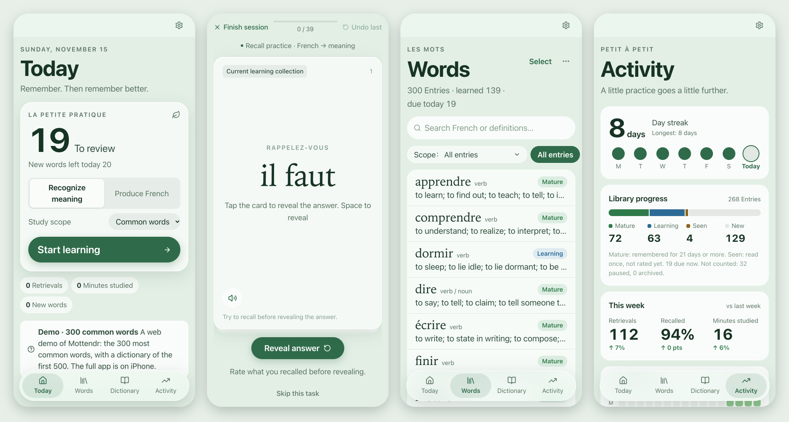

# Mottendr

[](https://github.com/beandecode/mottendr/actions/workflows/ci.yml)

**一个本地优先的法语词汇学习应用：先做成网页应用，现在又做成了原生 iPhone 应用。**
本仓库是它的网页版演示：**300 个最常用的法语词**，词典收前 500 个词，学习流程、统计和离线功能都是完整的。

- **在线演示：** <https://mottendr.givemeachance.qzz.io/app/>（可安装，可离线）
- **项目主页：** <https://mottendr.givemeachance.qzz.io>（一页式介绍）
- **iPhone 应用：** 将在 App Store 免费上架（尚未发布）。见[原生应用介绍](docs/ios.md)（英文）。
- **案例分析：** [为什么这样做、怎么做的](docs/case-study.md)（英文）
- **隐私与支持：** [隐私政策](docs/privacy.md) · [支持](docs/support.md)（中英双语）



<sub>截图来自已载入示例进度的在线演示；深色主题：[今日](docs/images/today-dark.png)、[词库](docs/images/words-dark.png)、[足迹](docs/images/activity-dark.png)；[词典](docs/images/dictionary-light.png)。</sub>

## 功能

- **FSRS-6 间隔复习**（`ts-fsrs`）：首次接触与评分回忆分开；每次回答都存为复习事件，支持并发冲突检测和撤销。
- **两个方向：** 法语 → 释义，释义 → 法语（中文、英文提示各有独立任务）。
- **结构化词条：** 词性与义项、性别、例句、词形、23 种变位、代词式动词、词族；中文、中英、纯英文三种解释模式。
- **本地优先：** 数据在浏览器里（IndexedDB），首次加载后可离线使用；无账号、无服务器、无追踪。
- **统计：** 连续天数、热力图、到期预测、各阶段进度。

## 技术要点

- **分层数据：** 内置词表是只读、有版本的内容包；学习者的数据只存与它不同的部分（笔记、自建词条、问题标记），按稳定 ID 对应。词包更新能到达所有未改动的字段，冲突列出来由你决定。
- **增量写入：** 变更经 immer 处理，只校验、写入变化的记录（一次复习约写 2 KB，而不是约 10 MB 的整体状态），写入带版本检查。
- **内容即数据文件：** 词包和词典是带哈希的 JSON，由手写的 Service Worker 预缓存。
- **单一结构定义：** 词条结构用 TypeBox 写一次，生成 TypeScript 类型、校验和 JSON Schema。
- **有测试的逻辑：** 调度、队列、分层、备份和统计都有固定输入的单元测试；同样的输入还生成黄金 JSON，用来检查原生 Swift 版本。

## 开发

需要 Node 24 和 pnpm（见 `package.json` 的 `packageManager`）。

```sh
pnpm install --frozen-lockfile
pnpm dev
pnpm check
pnpm test
pnpm build
```

## 演示版与完整应用

演示版只含经过完整检查的一小部分内容：首发词包按词频取前 300 个词作为词表，前 500 个词对应的词典记录作为词典；备份导入和恢复已关闭；今日页的按钮可以载入一个月的示例进度。完整的内容流程（约 4,100 词的词表、6,400 个词头的词典和改写流程）在私有仓库里。

## 许可

源代码：[MIT](LICENSE)。`content/` 里的学习内容：[CC BY-SA 4.0](content/LICENSE.md)，署名与来源见 [content/ATTRIBUTION.md](content/ATTRIBUTION.md)。

作者：[Bowen](https://github.com/beandecode)。
