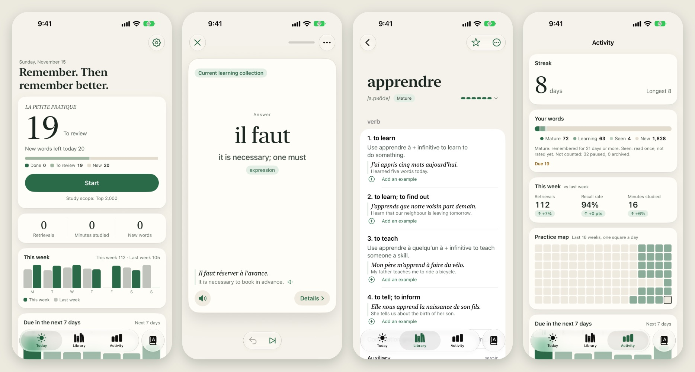
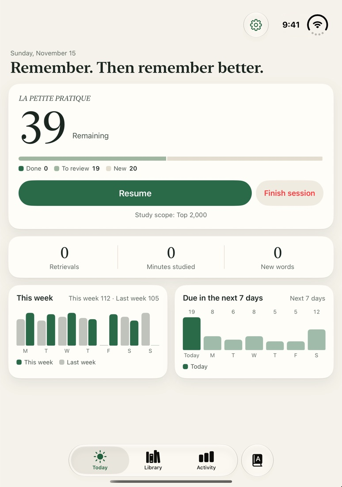
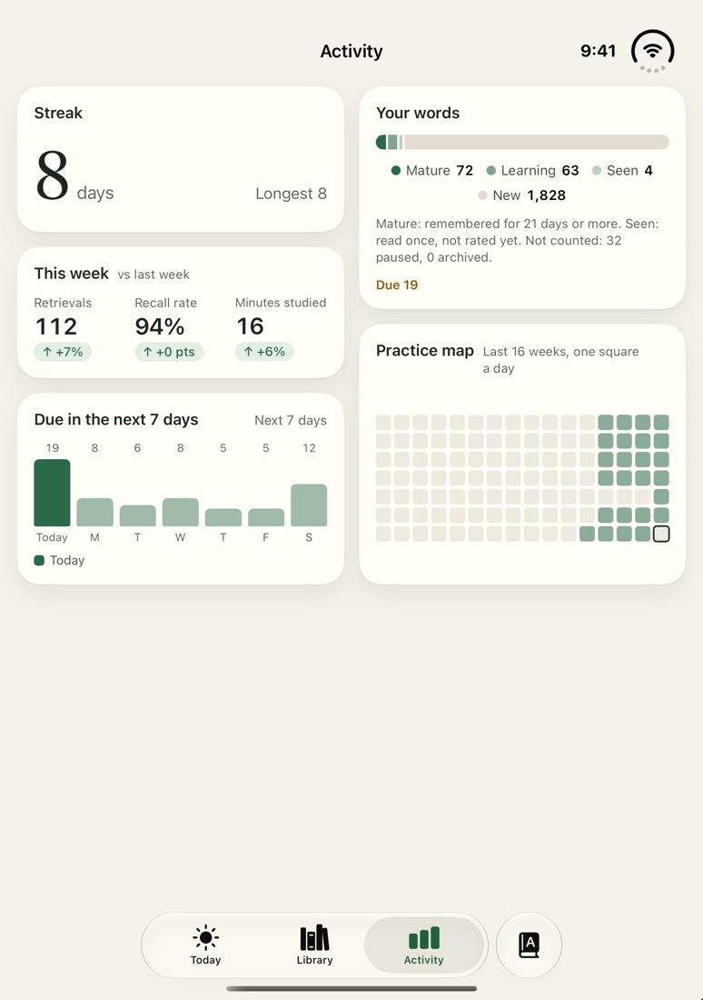
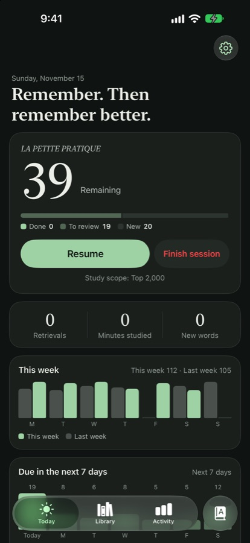

# The iPhone app

Mottendr also exists as a **native SwiftUI app**. The web version in this repository came first and still defines the
learning logic; the native app is a rewrite, not a wrapper. Its source code is private for now and available to
interviewers on request.

**Status:** in daily testing on a real iPhone; the first App Store release is planned as a free app and is not
released yet. A link will be added here when it is.

Screens of the native app in the simulator, loaded with the demo's synthetic progress (no real learner data).

On the iPhone Duo's inner display the same screens use the wide layout; dark mode follows the system.

## Why a native rewrite

What decides how the app feels (the card flip and drag, haptics, 120 Hz scrolling, layouts for a foldable phone's
outer and inner display) is native territory. A web view wrapped in a shell could only patch it. About 4,900 lines of
domain logic and their tests, written for the web version, became the specification for the port; the content and
the backup format stayed as they were.

## How it is built

- **MottendrCore**, a Swift package without UI: the FSRS-6 scheduler, domain types and validation, the layered
  data model (built-in pack plus the learner's patches), the learning queue and answers, backup restore, export
  and merge. It has its own Swift tests.
- **Content database.** The same TypeScript that builds the web app's content files also builds a bundled SQLite
  database (word list, dictionary, FTS5 trigram search), so the two apps cannot disagree about content.
- **User store.** The learner's data lives in SQLite with row-level, revision-checked saves; a daily snapshot and an
  undo for the last restore protect it.
- **SwiftUI app.** Study card with the same flip and rise as the web app, ink-style headword, swipe-only rating with
  tint and haptics, Today, Library (search, filters, batch actions), Dictionary (A to Z, search), entry page,
  Activity (streak, heat map, forecast), settings, backup and reminders.

## How parity with the web app is proven

The logic of the web version is the reference, and it is public in this repository. A test in the private repository
runs it on fixed inputs (pinned time zone, random source, clock and a small synthetic word pack) and writes golden JSON
files; the Swift package must reproduce every case, and the web tests fail if the logic changes without the files being
regenerated, so the two sides cannot drift apart unnoticed. The parity suite is shown together with the native source.

Results recorded during the port:

- every fixture case matches; scheduler values are bit-identical to `ts-fsrs`;
- on a Mac: word lookup 0 ms, slowest full-text search 6.9 ms.

## Content of the first release

The app ships the 1,999 most frequent words of the word list (Lexique lemma rank 2,000 or better), each one rewritten
and checked to a fixed definition of done and carrying an edition number. More words arrive with later updates. The
web demo's 300 words are the first 300 of the same pack.

## Contact

The native source can be shown in a walkthrough or shared read-only on request: see the profile of
[Bowen](https://github.com/beandecode).
